<div align="center">

<picture>
  <source media="(prefers-color-scheme: dark)" srcset=".github/assets/banner-dark.svg">
  
</picture>

**The Firebase services mobile teams need, behind PAM-native contracts.**<br>
Connect Analytics, Crashlytics, Remote Config, Messaging and Installations without coupling application code to vendor SDK objects.

[](https://packagist.org/packages/pushinbr/pam-native-firebase)
[](https://github.com/push-in/pam-native-firebase/releases/latest)

[](https://github.com/push-in/pam-native-firebase/actions/workflows/ci.yml)
[](LICENSE)

[Install](#install) · [Quick example](#quick-example) · [Platforms](#platform-support) · [Permissions](#requirements) · [Privacy](#privacy) · [API](#api-guide) · [Docs](#docs) · [Issues](https://github.com/push-in/pam-native-firebase/issues)

</div>

<a id="install"></a>
## <picture></picture> Install

Inside a PAM Native project, add only this capability:

```sh
pam composer require pushinbr/pam-native-firebase
pam doctor --fix
```

Android reads `.pam/google-services.json` through the PAM host; Apple uses the official Firebase Swift Package products. `pam composer require` updates the normal `composer.json` and `composer.lock`, and `pam doctor --fix` refreshes the generated native integration. Use `pam packages` to inspect the official capabilities. New to PAM? Create a project with `pam init my-app --template native` (see the [PAM Native overview](https://push-in.github.io/pam-docs/native/overview/)).

<a id="quick-example"></a>
## <picture></picture> Quick example

```php
use Pam\Native\Firebase\Firebase;
use Pam\Native\Firebase\FirebaseOperationState;
use Pam\Native\Firebase\RemoteFetchResult;

$firebase = new Firebase();

$firebase->logEvent('checkout_completed', [
    'order_id' => $order->id,
    'amount' => $order->total,
], static function (FirebaseOperationState $state, ?string $error): void {
    // Handle native acceptance or failure.
});

$firebase->fetchRemoteConfig(static function (RemoteFetchResult $result): void {
    // Activated, fetched, throttled, or failed.
});
```

Official Firebase integration for PAM Native: multi-app configuration, Analytics, Remote Config, Messaging token lifecycle, Installations and Crashlytics. Named apps can also be configured at runtime with `FirebaseAppOptions`. Incoming notification presentation and routing remain owned by PAM Native's notification capability; this package owns Firebase token and service APIs.

<a id="platform-support"></a>
## <picture></picture> Platform support

| Platform | Support | Notes |
| --- | --- | --- |
| Android | API 26+ | Pinned main Firebase modules (Analytics 23.2.0, Config 23.1.0, Crashlytics 20.1.0, Messaging 25.1.1), not the discontinued KTX artifacts |
| iOS | 15.0+ | firebase-ios-sdk 12.17.0 Swift Package: FirebaseAnalyticsCore, Core, Crashlytics, Installations, Messaging, RemoteConfig |
| PAM Native | 0.8.0 to < 2.0.0 | From `pam-native.plugin.json`; PHP 8.5+ |

<a id="requirements"></a>
## <picture></picture> Permissions and requirements

| Platform | Declared by the plugin |
| --- | --- |
| Android | `android.permission.ACCESS_NETWORK_STATE`, `android.permission.INTERNET`, `android.permission.WAKE_LOCK` |
| iOS | No usage descriptions |

The default app needs `.pam/google-services.json` (Android) and the Apple Firebase configuration. Platform SDKs, credentials, entitlements, physical hardware and store configuration remain application responsibilities.

<a id="privacy"></a>
## <picture></picture> Privacy: no IDFA

On iOS the plugin links the `FirebaseAnalyticsCore` Swift product (`GoogleAppMeasurementCore`), not `FirebaseAnalytics`, which also pulls `GoogleAppMeasurementIdentitySupport` (IDFA) and `GoogleAdsOnDeviceConversion`. `logEvent`, `setUserId` and `setUserProperty` work the same without them; no API of this plugin needs IdentitySupport. An app that does want IDFA-based attribution adds the `FirebaseAnalyticsIdentitySupport` product itself (an explicit opt-in that also requires App Tracking Transparency).

<a id="what-you-can-build"></a>
## <picture></picture> What you can build

- Product analytics and conversion events
- Crash diagnostics with application context
- Push messaging and remotely controlled behavior

| | |
| --- | --- |
| **Native path** | Firebase Android SDK · Firebase Apple SDK |
| **Application model** | Composer package + generated native integration |
| **Design rule** | Independent module; no feed, vertical or application template bundled |

<a id="api-guide"></a>
## <picture></picture> API guide

| API | Responsibility |
| --- | --- |
| `Firebase` | Configure apps and access Analytics, Remote Config, Messaging, Installations and Crashlytics. |
| `FirebaseAppOptions` | Configure named Firebase applications. |
| `RemoteFetchResult` | Typed Remote Config fetch/activation result. |
| `Firebase::remoteValue()` | Read one provider-neutral Remote Config document. |

Firebase deliberately does not depend on the feature-flags, sync, HTTP or any other PAM Native plugin. Compose capabilities in application code: pass the string returned by `remoteValue()` to whichever independent consumer you chose.

All coded states, kinds and variants are sequential integer-backed enums. Use enum cases in application code; do not depend on raw wire numbers.

<a id="production-checklist"></a>
## <picture></picture> Production checklist

- Use platform configuration files for the default app and runtime options only for named apps.
- Keep notification routing in PAM Native and Firebase token ownership in this package.
- Never place service-account or server credentials in the mobile bundle.
- Run `pam doctor`, `pam test`, and a signed release build on every supported platform.
- Exercise denial, cancellation, backgrounding, process restart and offline behavior before release.

<a id="troubleshooting"></a>
## <picture></picture> Troubleshooting

- **Default app is missing:** confirm `.pam/google-services.json` and the Apple configuration are present.
- **Events do not appear immediately:** Firebase Analytics delivery is intentionally buffered.
- **Remote Config is throttled:** respect `RemoteFetchResult` and the minimum interval.
- **Native integration is stale:** run `pam doctor --fix`, rebuild the native host, and inspect the first reported diagnostic.

Security vulnerabilities should be reported through the repository security policy or GitHub private vulnerability reporting, not a public issue.

<a id="docs"></a>
## <picture></picture> Docs

- [Plugin and native capability model](https://push-in.github.io/pam-docs/native/plugins/)
- [PAM Native overview](https://push-in.github.io/pam-docs/native/overview/)
- [PAM introduction](https://push-in.github.io/pam-docs/introduction/)
- [Changelog](CHANGELOG.md)
- [Report an issue](https://github.com/push-in/pam-native-firebase/issues)

<a id="pam-ecosystem"></a>
## <picture></picture> Part of the PAM ecosystem

<p align="center"><picture>
  <source media="(prefers-color-scheme: dark)" srcset=".github/assets/pam-wordmark-dark.svg">
  
</picture></p>

PAM runs PHP natively on servers, desktops and phones. This repository is one piece of it.

| [**PAM**](https://github.com/push-in/pam) | [**PAM Desktop**](https://github.com/push-in/pam-desktop) | [**PAM Native**](https://github.com/push-in/pam-native) | [**Ecosystem**](https://github.com/push-in/pam#ecosystem) |
| --- | --- | --- | --- |
| the runtime and CLI | native desktop apps in PHP | native Android and iOS apps in PHP | every official package and plugin |

<sub>Docs: [push-in.github.io/pam-docs](https://push-in.github.io/pam-docs/introduction/) · [Issues](https://github.com/push-in/pam-native-firebase/issues)</sub>

<p align="center"><sub><a href="LICENSE">Apache License 2.0</a> · Made in Brazil by Pushin</sub></p>
